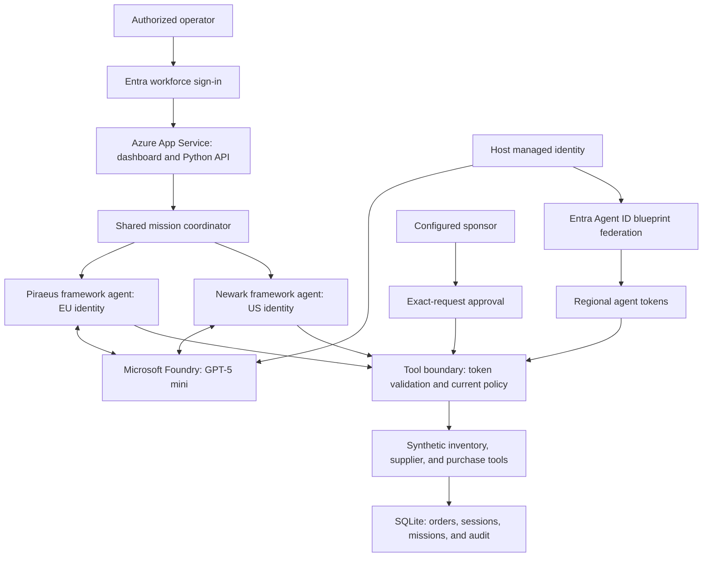
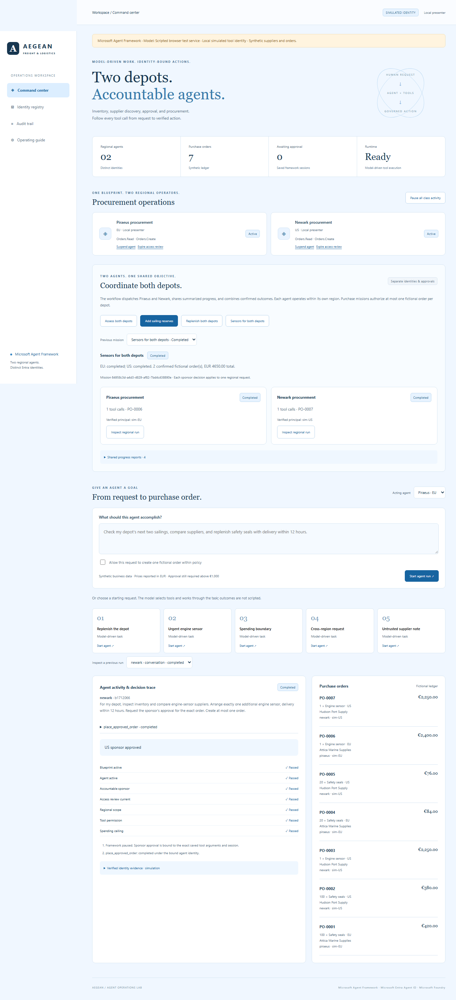

<p align="center">
  <a href="#tech-stack">
    
  </a>
</p>

<h1 align="center">Aegean Freight — Agent Governance Lab</h1>

**Two regional AI agents. Distinct Entra identities. Human oversight at the tool boundary.**

[Operating manual](docs/operating-manual.md) · [Demo walkthrough](#recommended-first-demonstration) · [Tech stack](#tech-stack) · [Architecture](#architecture) · [Documentation](#documentation)

## Introduction

Two AI procurement agents help a fictional shipping company supply its Piraeus and Newark depots. This Azure-hosted demo combines **Microsoft Agent Framework**, **Microsoft Foundry model inference**, and **Microsoft Entra Agent ID** to show how useful agent work can remain identifiable, limited, subject to human approval, and auditable.

**Start here: [Operating manual](docs/operating-manual.md).** It introduces the project for first-time readers and provides the complete browser walkthrough, expected outcomes, governance rules, and troubleshooting.

**Deployed application:** [Aegean Agent Operations](https://app-aegean-agents-c6e08b90.azurewebsites.net/). Sign in with an account authorized for this deployment. Presenters do not need to install or deploy anything.

## Features

- Each regional framework agent uses a model to inspect inventory, compare offers, and propose purchases through executable tools.
- Both agents have distinct Entra identities under one agent identity blueprint. Protected tools validate real agent tokens and independently enforce application policy.
- Regional boundaries, spending limits, request authority, and lifecycle controls constrain execution. Both identities have Orders.Read and Orders.Create; their region restrictions are application policy.
- Purchases above €1,000 pause for the configured sponsor to approve an exact request, then resume the saved framework session. A purchase cannot exceed €5,000.
- Shared missions dispatch both agents, exchange limited progress summaries, and show combined confirmed results, separate approvals, and partial completion.
- Operators inspect tool activity, verified identity claims, persistent fictional orders, and correlated audit events.

The agent runtime, deployed model calls, workforce sign-in, directory identities, and live tool-token exchange are real. Inventory, suppliers, sailings, prices, and purchase orders are synthetic; no payment or supplier communication occurs. The application's pause, suspension, and review controls do not configure native Entra governance policies.

## Recommended first demonstration

1. Open **Identity registry** and identify the blueprint and two regional identities.
2. Run **Assess both depots** for research without purchasing.
3. Run **Add sailing reserves** to request 20 additional seals in each region. Inspect both traces, identity evidence, and confirmed orders.
4. Run **Sensors for both depots** and approve each region separately as its configured sponsor.
5. Demonstrate **Cross-region request**, then suspend Newark and run a reserve mission to inspect partial completion. Reactivate it afterward.
6. Correlate the mission and run IDs in **Audit trail** and export the events.

Model behavior varies, and historical orders affect inventory coverage. The operating manual explains what evidence establishes success and how to repeat presentations without resetting data.

## Tech stack

| Layer | Technologies and responsibilities |
|---|---|
| Frontend | HTML, CSS, and JavaScript; light blue operations dashboard, identity registry, approvals, and audit views. |
| Agent runtime | Microsoft Agent Framework; separate regional sessions, model-selected tools, and approval/resume. |
| Backend | Python, FastAPI, and Uvicorn; coordination, authorization, tool execution, and API routes. |
| Model inference | GPT-5 mini through Microsoft Foundry, authenticated with the host managed identity. |
| Identity | Microsoft Entra Agent ID blueprints and agent identities; workforce sign-in through App Service authentication. |
| Persistence | SQLite for fictional orders, saved sessions, mission state, and application audit events. |
| Azure hosting | Linux App Service on P0v3, with Foundry and Key Vault in the same resource group. |
| Infrastructure and operations | Bicep, PowerShell, and Azure CLI. |

## Architecture

The light blue UI and Python backend run in the existing Azure Web App on a P0v3 plan. Microsoft Agent Framework runs there; Foundry hosts the model, rather than the agent runtime. The Foundry account, project, and model deployment share the application's resource group in Sweden Central. The host managed identity accesses model inference and blueprint federation; regional agent identities authenticate protected business tools.



### Application preview



This repository screenshot comes from browser verification using scripted model responses. Use deployed runs and verified identity evidence to demonstrate live behavior.

## Documentation

| Guide | Purpose |
|---|---|
| [Operating manual](docs/operating-manual.md) | Start here: concept, browser operation, scenarios, evidence, governance, and troubleshooting. |
| [Coordinated missions](docs/collaboration-guide.md) | Detailed shared-mission behavior and acceptance steps. |
| [Framework architecture and maintenance](docs/agentic-upgrade.md) | Runtime design, configuration, deployment scripts, and startup diagnostics. |
| [Research](docs/research.md) | Sources and conceptual distinctions around agent identities and governance. |

## Local verification and maintenance

For the Python environment and deployment procedure, follow [the framework maintenance guide](docs/agentic-upgrade.md). With the existing development environment installed:

```powershell
.\.venv\Scripts\python.exe -m pytest test_agentic -q
```

The framework tests use scripted model responses and mocked live dependencies. Passing them does not establish successful Azure inference, tenant consent, or live token exchange; verify those through deployed runs and identity evidence.

The current application persists orders, sessions, and audit state in SQLite under `/home/data/aegean/agentic.sqlite` on App Service. It uses one worker. Production use requires business-system integration, storage/concurrency design for scale, protected audit retention, monitoring, and native tenant governance. The host can authenticate for both agents under the blueprint and is a shared trust boundary.

## Community and license

Contributions are welcome. Read the [contributing guidelines](CONTRIBUTING.md) and [Code of Conduct](CODE_OF_CONDUCT.md), then use the repository's bug-report or feature-request forms. Pull requests include a template for behavior, validation, and governance impact.

Report vulnerabilities privately using the [security policy](SECURITY.md). This project is distributed under the [MIT License](LICENSE); third-party materials retain their applicable licenses.

## Legacy offline fixture demo

The repository retains the original Node implementation for offline demonstrations. **It is a separate, older runtime with different scenarios and permissions; it is not the current deployed framework application.** With Node.js 24+:

```powershell
npm start
# Open http://localhost:3000
```

Its default simulation requires no account or model. Legacy Node configuration, fixture behavior, and tests apply to that runtime only.
