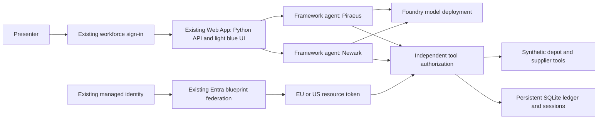

# Model-driven Aegean procurement demo

## Architecture decision

The new Python backend replaces Node **inside the existing Web App**. It keeps the URL, P0v3 plan, Easy Auth workforce registration/callback, host managed identity, blueprint federation, two agent identities, Key Vault, and light blue design. The existing Node source and its packaged ZIP remain available for rollback.

Microsoft Foundry is a separate `AIServices` account, project, and model deployment in the **same resource group**, `rg-aegean-agent-demo`, in **Sweden Central**. Microsoft Agent Framework runs in App Service; the agents are not hosted by Foundry Agent Service. Foundry supplies inference and a project for organizing the solution. This avoids an unnecessary second application/hosting environment while keeping a real framework-managed execution loop.



Model access uses the host managed identity and `Cognitive Services OpenAI User`. Business tools use the regional **agent identity's** verified resource token. Those identities serve different purposes. Agent IDs are bound by server code, not selected by the model or inferred from agent names.

## Both agents have a useful complete operation

Piraeus and Newark each inspect their own inventory, compare offers, purchase permitted quantities, pause for a sponsor's approval, and resume a saved framework session. Newark receives an explicit direct `Orders.Create` grant on the existing fictional Orders API; its identity is retained. Regional limits are application policy, even though both agents now have the same API roles.

The synthetic records include four vessels, next-sailing demand, three product types, eight regional supplier offers, inventory shortages, delivery lead times, and supplier text. EUR is the common reporting currency. The initial seal shortages are 100 units at both depots; the fast offers yield €420 for Piraeus and €380 for Newark. Sensors cost €2,400 and €2,250 and require approval. Compressors exceed the €5,000 ceiling.

Replenishment counts existing incoming orders. A second run may correctly conclude that no new order is needed. Ask for an explicit additional quantity to demonstrate another purchase. Neither inventory nor supplier tools call external businesses.

## Agentic behavior and enforcement

The actual `agent_framework.Agent` and `OpenAIChatClient` drive Azure OpenAI Responses calls and repeated tool execution. There is no production fixture fallback. Framework `AgentSession` checkpoints and pending approval requests are serialized server-side. An approval resumes the same session with a framework approval response bound to the exact saved call. The application separately verifies sponsor identity and exact arguments.

Each protected tool validates the regional scope, lifecycle controls, review deadline, token signature/issuer/audience/lifetime, bound principal/client, and required role. Purchases use server-calculated catalogue prices and a second policy check after token acquisition. A unique run may create at most one purchase order. The standard-order tool cannot execute above €1,000; the approved-order tool requires exact sponsor approval above that threshold. No bank export or external transfer tool is exposed.

The UI shows tool arguments/results, the model's final response, actual policy checks, approval details, identity evidence, and audit correlation. It does not display private model chain of thought, raw tokens, or framework checkpoints. Model refusal, server denial, and successful execution are different outcomes; inspect the trace rather than expecting every adversarial prompt to produce the same response.

Free-text requests are research-only until the presenter selects **Allow this request to create one fictional order within policy**. That grant is saved with the run; a model cannot enable it. The scenario cards carry their predefined task authority: procurement scenarios permit an order subject to policy, while the untrusted-note scenario is read-only. Cross-region purchase requests retain their requested region so the model cannot silently substitute its own depot to evade the test.

## Staged rollout — presenter runs cloud changes

The target subscription is **Visual Studio Enterprise Subscription** (`9d47bf93-091d-480e-a512-1e918864fee7`). No new App Service plan is needed. Foundry inference adds usage-based charges; the template selects `gpt-5-mini`, version `2025-08-07`, EU **DataZoneStandard**, capacity 30. Quota is checked again by the deployment script; quota availability does not guarantee service capacity. The catalog currently lists this version's retirement as February 9, 2027, so review the model before using this demo beyond that date.

1. Preview Foundry. The script verifies subscription, provider registration, model/SKU, and quota. It does not modify the Web App.

   ```powershell
   pwsh -NoProfile -File .\scripts\Deploy-Foundry.ps1
   ```

2. Apply Foundry after reviewing the preview. This creates the account, project, model deployment, and model-access assignment for the existing managed identity. Outputs contain no secrets.

   ```powershell
   pwsh -NoProfile -File .\scripts\Deploy-Foundry.ps1 -Apply
   ```

3. Grant both existing agents order creation and verify the directory configuration. This is an explicit Entra permission change, not a framework setting. No directory administration permission is granted to the running agents.

   ```powershell
   pwsh -NoProfile -File .\scripts\Enable-AgentOrdering.ps1
   pwsh -NoProfile -File .\scripts\Test-Identity.ps1 -BothAgentsCanOrder
   ```

4. Package and publish the replacement. Publication saves non-secret runtime settings for rollback, configures Python 3.13 and Oryx dependency build, updates only model/build settings, deploys the ZIP, and checks startup. The Web App restarts. Authentication settings are untouched.

   ```powershell
   pwsh -NoProfile -File .\scripts\Package-Agentic.ps1
   pwsh -NoProfile -File .\scripts\Publish-Agentic.ps1
   ```

5. Sign in, open **Operating guide**, and validate **both** agents. Health only proves startup and configuration; it does not prove inference or agent authentication. Run each depot's replenishment, inspect each distinct identity, approve a sensor for each depot, and test cross-region/spending/lifecycle denials. Let model-access RBAC propagate if initial model calls are denied.

On first startup the application imports historical orders and audit events from `/home/data/aegean/state.json`, leaving that file untouched. Old runs remain archived in the JSON file; framework sessions use `/home/data/aegean/agentic.sqlite`. If rolling back, new Python orders remain in SQLite and are not merged into the Node ledger.

For another subscription/group, pass the target arguments to the scripts and provision matching Entra identities/host infrastructure first. Foundry is declared in `infra/foundry.bicep`. For full host IaC redeployment, use `applicationRuntime=python`, `plannerMode=microsoft-agent-framework`, and the Foundry model endpoint/deployment in `infra/main.bicep` or `infra/subscription.bicep`. The legacy defaults intentionally remain Node/fixture; using them after migration would revert the host configuration.

## Rollback

The October 18 deployment `91707df5-fc14-4368-91df-c060b89eb2ce` completed its build and started the worker successfully, but Azure CLI startup tracking reported a timeout. Live `/healthz` returned Entra/framework/model-configured status, and Azure startup logs recorded a successful probe about ten seconds after container startup. The publisher now uses `--track-status false`, retains deployment/build error handling, and checks the application health endpoint separately. Do not republish a healthy app just to clear the earlier CLI tracker message.

If Python startup reports `No module named uvicorn` and deployment logs show `Skipping build. Project type: Run-From-Zip`, the Python dependency build did not run. The publisher now removes `WEBSITE_RUN_FROM_PACKAGE` and `WEBSITE_RUN_FROM_ZIP` entirely, enables both remote-build flags, and verifies them before deploying. Rebuild with `Package-Agentic.ps1` and republish with `Publish-Agentic.ps1`; the ZIP includes `.deployment` to explicitly request build automation. Python run-from-package is [unsupported by App Service](https://learn.microsoft.com/en-us/azure/app-service/deploy-run-package).

If the first Foundry apply fails with `RequestConflict` during project creation, inspect the deployment operations before removing anything. The initial rollout created the account, model, and access assignment successfully while the concurrent project write conflicted. The corrected template explicitly orders project creation before model deployment. Once the account is settled, rerun `scripts/Deploy-Foundry.ps1 -Apply` to reuse those resources and finish the project/output file.

Keep `artifacts/aegean-app.zip` and `artifacts/agentic-rollback.json`. Restore the previous runtime/settings and original Node package with:

```powershell
pwsh -NoProfile -File .\scripts\Publish-Agentic.ps1 -Rollback
```

Foundry remains deployed and Newark's explicit create grant remains present. If returning to the original read-only Newark demonstration, remove that specific grant separately and verify the original policy; the rollback does not silently revoke directory permissions. Do not run the legacy publisher against the Python runtime.

## Local validation

Validate hosted startup in a **separate environment installed only from deployment requirements**. This exercises the real App Service managed-identity credential constructor and HTTP health endpoint using synthetic configuration, without any Azure/model calls:

```powershell
python -m venv .venv-deploy
.\.venv-deploy\Scripts\python.exe -m pip install -r requirements.txt
.\.venv-deploy\Scripts\python.exe .\scripts\Check-AgenticStartup.py
```

The deployment requires `aiohttp` explicitly because it uses `azure.identity.aio`. An earlier development environment included it transitively through another package, masking the missing dependency until hosted startup. The corrected requirements include it directly. This clean startup check complements the framework tests below; it does not verify live managed-identity token acquisition.

```powershell
python -m venv .venv
.\.venv\Scripts\python.exe -m pip install -r requirements.txt
.\.venv\Scripts\python.exe -m pip install pytest pytest-asyncio
.\.venv\Scripts\python.exe -m pytest test_agentic -q
```

The tests use the real framework and SDK against a scripted model HTTP service, and signed test JWTs for token validation. They prove framework/tool integration, identity binding, persisted approval/resume, replay prevention, cross-region/overspend/approval-bypass denial, lifecycle rechecks, and HTTP access controls. They do not prove live model behavior, tenant consent, or runtime federation. Live acceptance remains a required deployment step.

For local real inference, configure `AZURE_OPENAI_ENDPOINT` and `AZURE_OPENAI_DEPLOYMENT`, sign into Azure CLI with model access, and start `.venv\Scripts\python.exe -m uvicorn backend.app:app --host 127.0.0.1 --port 3000`. Local tool identity is explicitly simulated; App Service requires live Entra mode. The existing `npm start` remains the legacy fixture demo.

This remains a single-worker demo with durable SQLite checkpoints. Multi-instance workers need shared transactional storage and distributed coordination. The [collaboration enhancement](collaboration-guide.md) adds application-managed shared missions: each regional framework agent receives summarized peer progress while retaining its own identity, task authority, and sponsor approval. Regional execution remains serialized.

## Primary references

- [Microsoft Agent Framework overview](https://learn.microsoft.com/en-us/agent-framework/overview/)
- [Framework tool approval and session binding](https://learn.microsoft.com/en-us/agent-framework/agents/tools/tool-approval)
- [Foundry account/project Bicep schema](https://learn.microsoft.com/en-us/azure/templates/microsoft.cognitiveservices/2025-06-01/accounts/projects)
