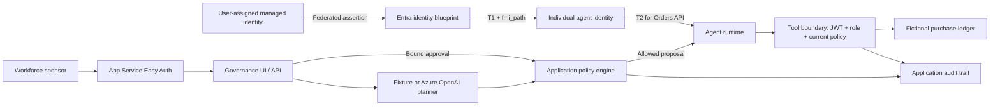

# Architecture and enforcement

## Trust boundaries

The browser can select a scenario and agent, request a governance operation, or approve a pending run. It cannot supply tool arguments, token claims, permission grants, or a new identity. On Azure the API verifies the Easy Auth workforce principal's tenant and explicit object-ID allowlist. Approval additionally checks the configured sponsor's object ID. Only App Service hosting with enabled platform authentication is supported; do not expose the Node process directly while trusting its `x-ms-client-principal` header. [App Service user identities](https://learn.microsoft.com/en-us/azure/app-service/configure-authentication-user-identities).

The planner proposes one tool action. In fixture mode, the selected scenario defines that proposal. In model mode, Azure OpenAI returns a function call; the server validates its schema and prevents changes to the requested amount, item, or region. Model refusal, malformed output, or service errors fail closed.

The policy engine resolves the agent from the server-side registry and checks blueprint/agent status, sponsor presence, review deadline, tool grant, region, monetary ceiling, and human approval. Approval is attached to the server's stored proposal, cannot be replayed, and does not bypass subsequent checks.

The runtime acquires a signed capability (simulation) or a real Entra resource token (live). The tool boundary verifies the token, matches its principal/client to the server registry, requires the role, and re-evaluates current policy. It also verifies the run is executable and has not already produced an order. Token acquisition failures produce a denied execution with no order.

The tool boundary is a separately defined function in the same process for this demonstration. It is not a separately deployed API or public tool endpoint. The live token's audience is the separately registered logical Orders API application. A production deployment should place this boundary in its own API and validate tokens there using a maintained identity library. Only the autonomous v2 RS256 token shape used by this demo is supported by its narrow validator.

## Azure resources

| Resource | Purpose |
|---|---|
| Linux App Service, B1, Node 24 | Serves UI, policy API, worker, and tool boundary; one process, one instance |
| User-assigned managed identity | Federated blueprint credential and Key Vault secret access |
| Key Vault | Workforce login secret; RBAC and soft delete |
| Log Analytics | Workspace for optional platform diagnostics |
| Application Insights | Monitoring resource reserved for optional instrumentation; no automatic tracing SDK is installed |
| Entra workforce app + service principal | Human console sign-in; separate from agent identities |
| Entra tool API app + service principal | Defines `Orders.Read` and `Orders.Create` app roles; requests v2 tokens |
| Entra blueprint + blueprint principal | Shared agent class and credential boundary |
| Two Entra agent identities | Distinct per-agent resource authorization and attribution |

The audit JSON stays on the App Service persistent `/home` share. Optional Azure diagnostics capture platform traffic and console output when `enableDiagnostics=true`; they default off for initial provisioning. They are **not** an immutable export of all application audit events. The UI exports those events explicitly. Key Vault is network accessible with Entra RBAC in this demo; production network isolation is an additional design step.

## Native capability versus local demonstration

| Control | This repository implements | Native tenant counterpart to configure separately |
|---|---|---|
| Blueprint/identity | Simulated registry; live typed Graph provisioning | Entra agent inventory |
| Authentication | MI federation + two-step autonomous exchange | Entra token issuance and sign-in logs |
| API permissions | Direct app-role assignments and token role verification | Consent and service principal grants |
| Human accountability | Displayed sponsor and object-ID-bound approval | Owners, sponsors, entitlement management |
| Pause / suspension | Immediate local execution control | Tenant identity/blueprint disable and policy |
| Review expiry | Application deadline | Entitlement lifecycle/access governance appropriate to tenant |
| Region / spending | Resource-side business authorization | Application controls remain necessary |
| Risk policy | Not provisioned | Conditional Access and Identity Protection |
| Audit | Correlated application events and JSON export | Entra sign-in/audit logs and protected event sink |

## Reliability limits

Synchronous JSON replacement persists the single-process state; a process-wide operation lock prevents concurrent execution in that process. Runs interrupted by restart never automatically re-execute. This is not a distributed transaction or a tamper-proof journal. Do not scale to multiple instances or worker processes with this storage. Use a transactional database, unique run/order constraints, an outbox, and a protected external audit sink before adding real business tools.
